# Clausario User Manual

> **Educational use only.** Proof of concept, not production-ready, not legal advice and no compliance certification. Use synthetic data only. Provided "as is". See the full notice in [README.md](../README.md).

Clausario turns a user story into compliance test scenarios. It checks which regulation applies (GDPR, EU AI Act, both or none), picks the relevant articles, asks a person to review when it is unsure, writes test scenarios and scores them.

This manual covers every menu, for Admins and for normal users. Screenshots come from a demo setup with sample data, so names, scores and costs in your installation will differ.

**PDF version:** [USER_MANUAL.pdf](USER_MANUAL.pdf) (same content, for download or print).

## Contents

1. [Roles and menu access (RBAC)](#1-roles-and-menu-access-rbac)
2. [Signing in and out](#2-signing-in-and-out)
3. [The layout](#3-the-layout)
4. [Overview](#4-overview)
5. [New analysis](#5-new-analysis)
6. [Runs](#6-runs)
7. [Run detail](#7-run-detail)
8. [Review queue (human review)](#8-review-queue-human-review)
9. [Knowledge base](#9-knowledge-base)
10. [Engines & models](#10-engines--models)
11. [Users (Admin)](#11-users-admin)
12. [Menu access (Admin)](#12-menu-access-admin)
13. [No access page](#13-no-access-page)
14. [Common tasks](#14-common-tasks)
15. [Troubleshooting](#15-troubleshooting)

---

## 1. Roles and menu access (RBAC)

Clausario has two roles. The screen shows the stored role `Tester` as **User**.

| Role | What it gets |
|---|---|
| **Admin** | Every menu, every user's runs, and the two admin-only menus (Users, Menu access). |
| **User** | Only the menus an Admin grants. A new User gets `MENU_DEFAULT_TESTER` from `backend/.env` (by default Overview, New analysis and Runs) until an Admin changes it. |

### Menus

| Menu | Group | What it is for | Who can have it |
|---|---|---|---|
| Overview | Workspace | KPI tiles and recent runs | Admin, any User granted it |
| New analysis | Workspace | Start a run from a user story | Admin, any User granted it |
| Runs | Workspace | List and open your runs | Admin, any User granted it |
| Review queue | Governance | Review runs that scored below the threshold | Admin, any User granted it (a "reviewer") |
| Knowledge base | Knowledge | Sync the regulation text | Admin, any User granted it |
| Engines & models | Administration | Read-only view of engine and model settings | Admin, any User granted it |
| Users | Administration | Add, edit, deactivate accounts | **Admin only** |
| Menu access | Administration | Grant menus per user | **Admin only** |

### Typical profiles

The examples in this manual use these demo accounts:

| Account | Role | Menus | Profile |
|---|---|---|---|
| `admin` | Admin | All | Administrator |
| `priya` | User | Overview, New analysis, Runs | Analyst (normal user) |
| `arjun` | User | Overview, Runs, Review queue | Reviewer |
| `meera` | User | Overview, New analysis, Runs, Knowledge base, Engines & models | Senior analyst |
| `rahul` | User | Overview, New analysis, Runs | Deactivated account |

### What you can see

| | Admin | User with Runs | User with Review queue |
|---|---|---|---|
| Own runs | Yes | Yes | Only if they also have Runs |
| Other users' runs | Yes | No (they don't exist for you) | Only runs that are waiting for review or were reviewed |
| Act on a review | Yes | No | Yes |

The server enforces all of this. Hiding a menu is only the visible part: a User who types an API address or page URL for a menu they don't have is refused. A run you are not allowed to see behaves as if it doesn't exist ("Run not found").

Access changes apply on your **next request**. You don't need to sign out and back in; refreshing the page is enough.

---

## 2. Signing in and out

Open Clausario in your browser (by default `http://localhost:5173`) and sign in with the username and password your Admin gave you.

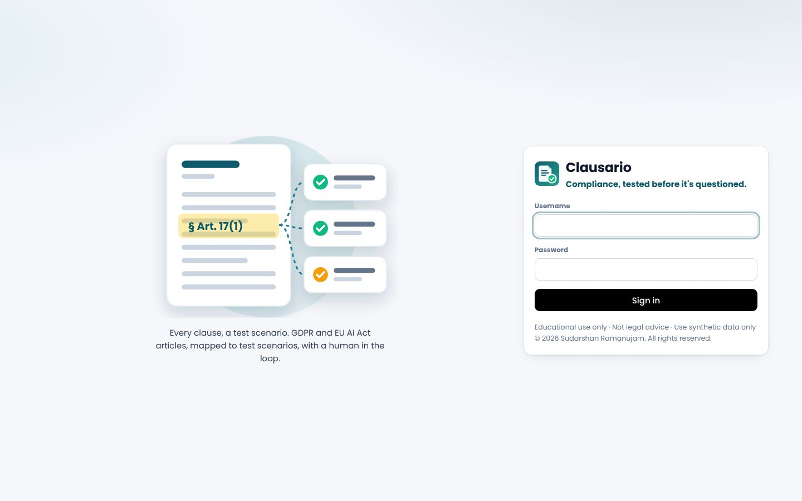

Under the Sign in button, the page shows the notice (*Educational use only · Not legal advice · Use synthetic data only*) and the copyright line.

A wrong username and a wrong password give the same message, so the page never reveals which accounts exist. After several failed attempts the server asks you to wait before trying again.

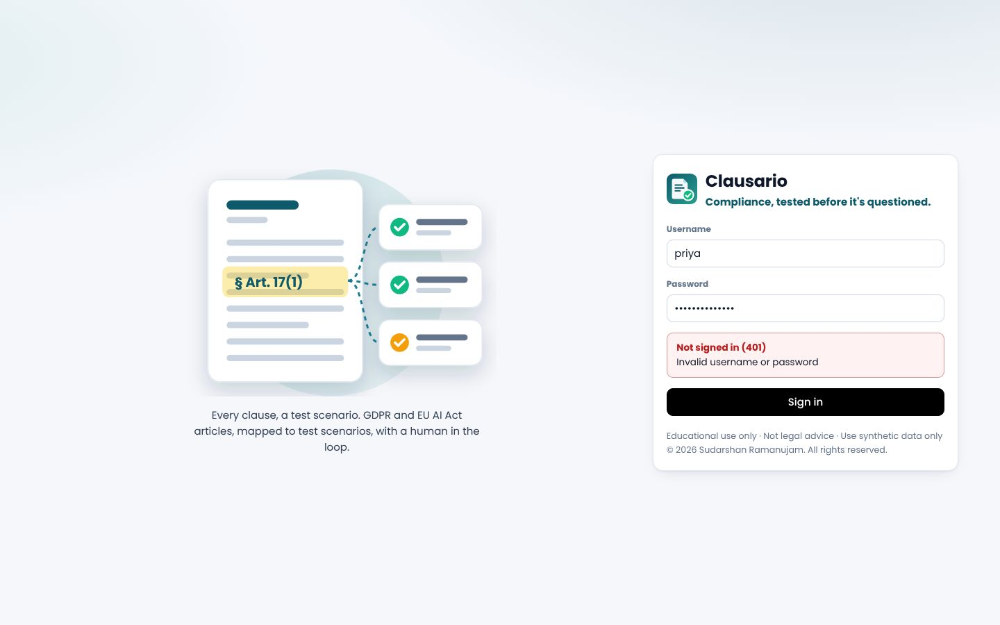

Your session lasts `SESSION_HOURS` (8 hours by default). A deactivated account is signed out on its next request.

**The account menu** (your avatar in the top-right corner) has two items:

- **About Clausario** opens the About panel (see [The layout](#3-the-layout)).
- **Sign out** ends your session.

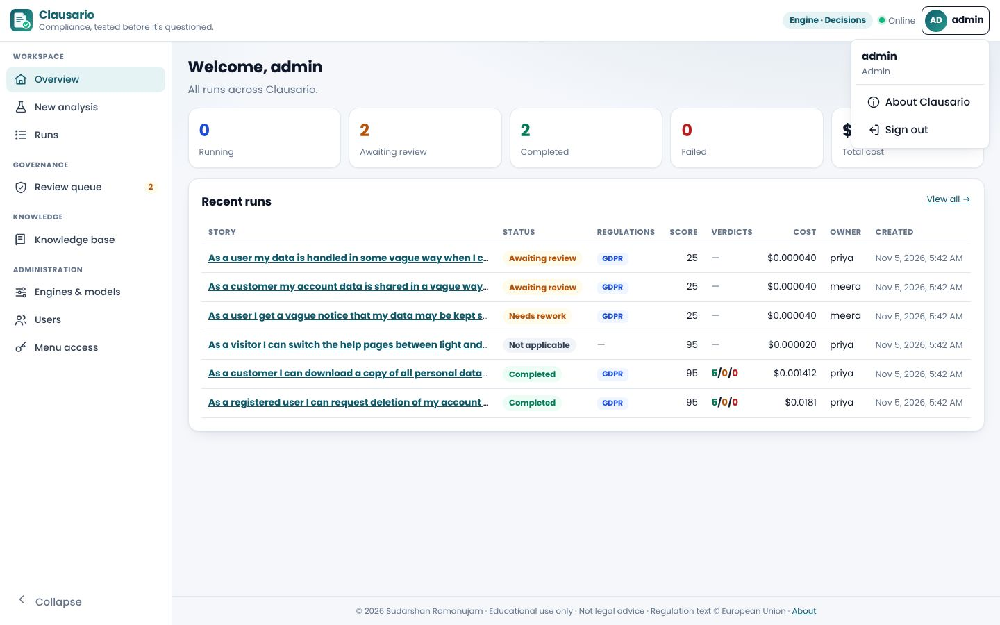

---

## 3. The layout

- **Top bar:** logo and caption (*Compliance, tested before it's questioned.*), the default classification engine (for example *Engine · Decisions*), a backend status dot (*Online*), and your account menu.
- **Sidebar:** your menus, grouped into Workspace, Governance, Knowledge and Administration. Groups with no granted menus are hidden. The Review queue item shows a badge with the number of runs waiting.
- **Collapse:** the **Collapse** button at the bottom of the sidebar turns it into an icon rail. Hover an icon to see its name. The browser remembers your choice.

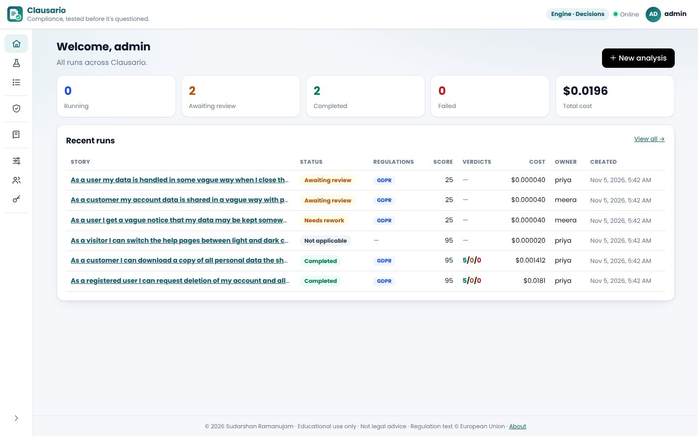

**On phones and narrow windows** (below 1024 px), the sidebar becomes a drawer. Tap ☰ to open it; tap outside or pick a menu to close it.

| Phone | Menu open |
|---|---|
| 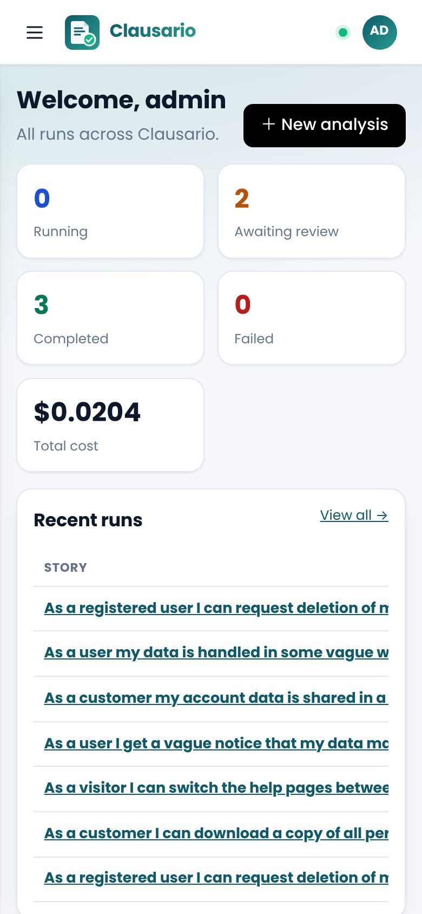 | 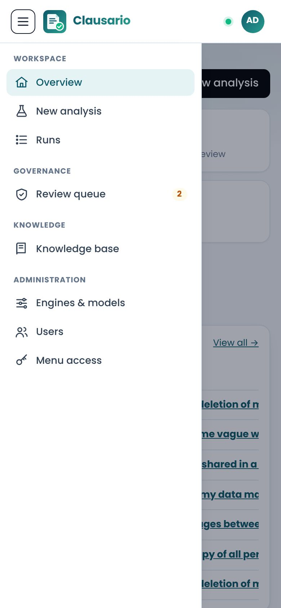 |

Light and dark themes follow your operating system.

**Footer:** every page ends with the copyright and notice line (*© 2026 Sudarshan Ramanujam · Educational use only · Not legal advice · Regulation text © European Union*) and an **About** link.

**About Clausario** opens from the account menu or the footer's **About** link. It shows:

- the full notice: educational use only, decision support only, no real personal data, provided "as is";
- where the GDPR and EU AI Act text comes from, with links to each source site and to the official text on EUR-Lex;
- the EU reuse credit and the copyright line.

Press Escape or click outside the panel to close it.

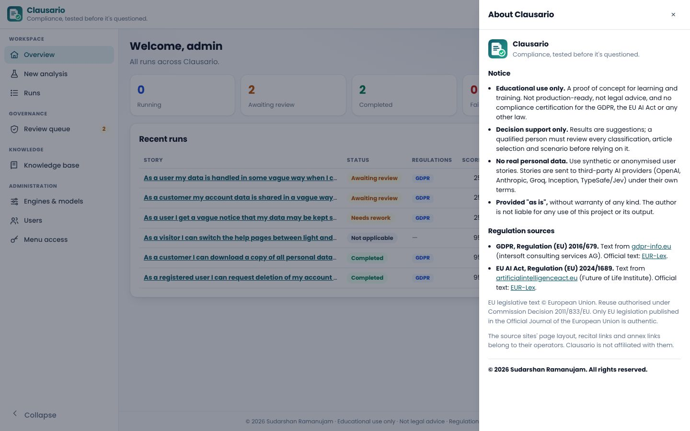

---

## 4. Overview

The landing page after sign-in.

- **KPI tiles:** Running, Awaiting review, Completed, Failed and Total cost.
- **Recent runs:** the 10 newest runs, with status, regulations, review score, verdicts (pass / warn / fail), cost and created time. Click a story to open the run. **View all** opens Runs.
- **+ New analysis** appears when you have the New analysis menu.

**Admin view:** all runs in Clausario, with an Owner column.

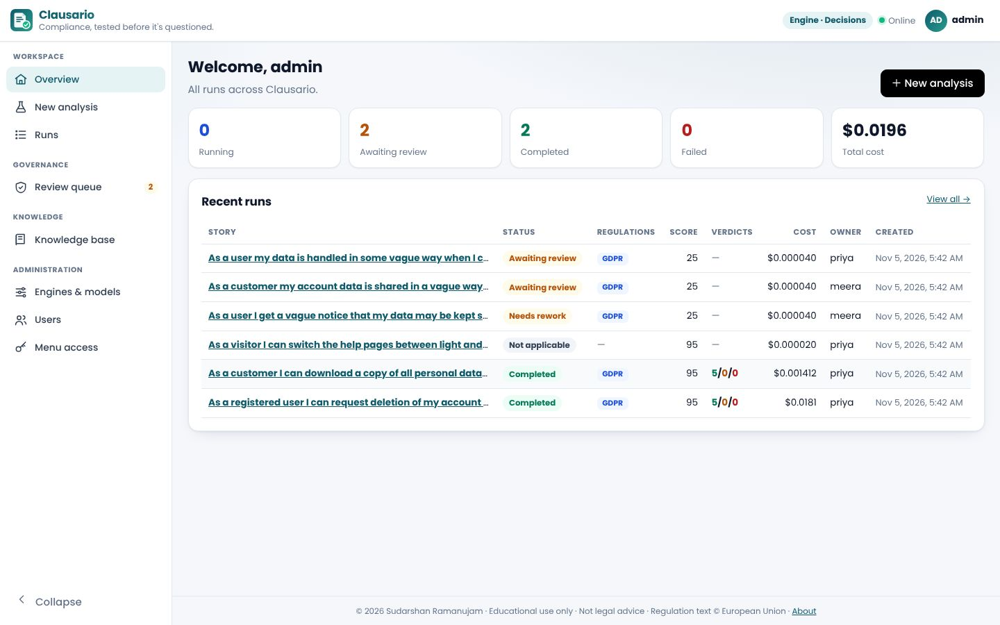

**User view:** only your own runs and your own cost.

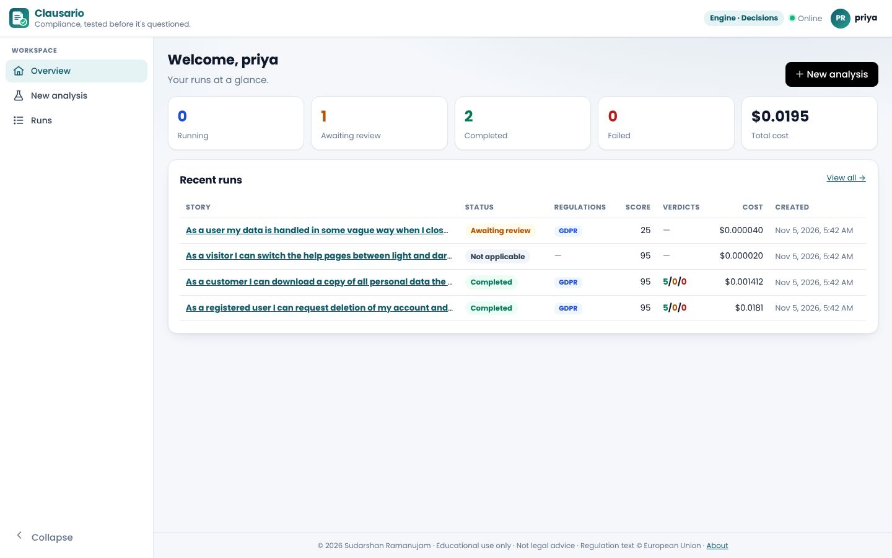

**Reviewer view:** the *Awaiting review* tile counts the whole review queue, so a reviewer sees work waiting even with no runs of their own.

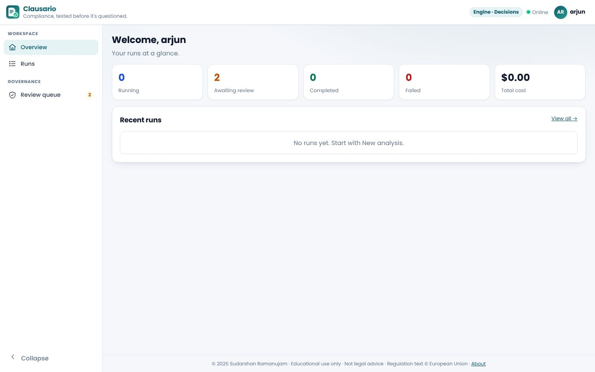

---

## 5. New analysis

*Menu: New analysis.* Start a run from a user story or requirement.

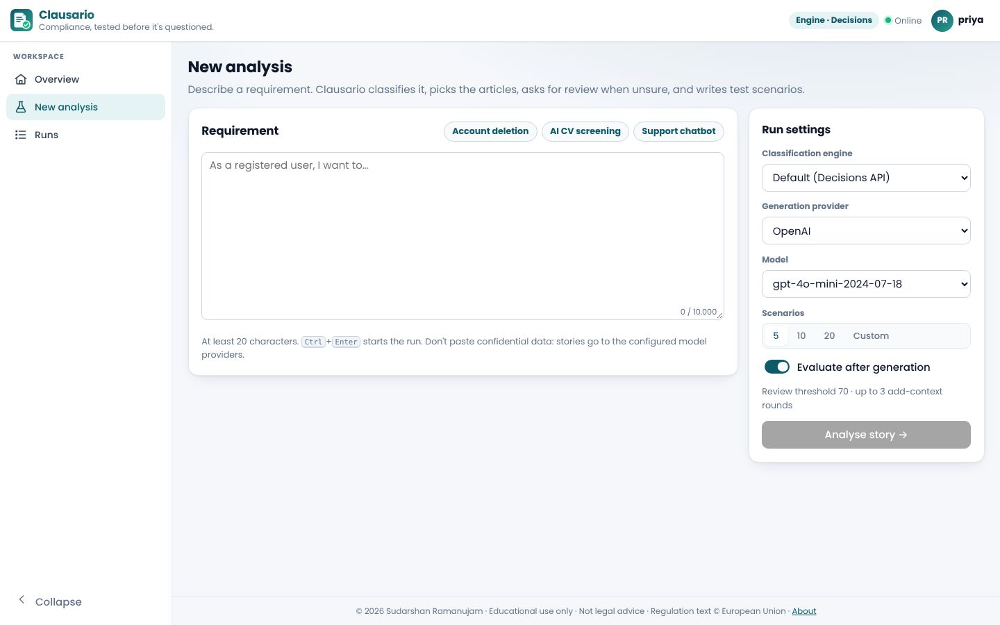

1. **Write the story** in the Requirement box, at least 20 characters. The chips **Account deletion**, **AI CV screening** and **Support chatbot** fill in examples. Don't paste confidential data: the story is sent to the configured model providers.
2. **Check the Run settings** on the right:
   - **Classification engine:** *Default* uses the engine set in `.env`; you can pick Decisions API or Jev for this run. This selector appears only when `ENGINE_UI_SWITCH=true`.
   - **Generation provider** and **Model:** the LLM that writes the scenarios (OpenAI, Anthropic, Groq or Inception, whichever have keys).
   - **Scenarios:** 5, 10, 20 or Custom (up to `SCENARIO_MAX_COUNT`).
   - **Evaluate after generation:** scores each scenario. Hidden when evaluation is turned off in `.env`.
   - The line under the toggle shows the review threshold and how many add-context rounds a reviewer gets.
3. Click **Analyse story →** or press <kbd>Ctrl</kbd>+<kbd>Enter</kbd>.

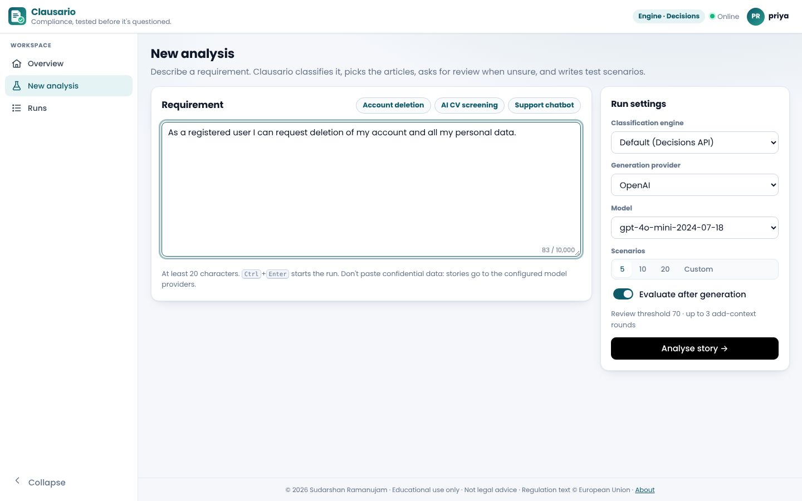

The run page opens straight away and updates every 2 seconds while the run works through its steps.

---

## 6. Runs

*Menu: Runs.* A table of runs with filters across the top: **All, Running, In review, Completed, Rework, N/A, Failed.** Long lists are paged.

A **User** sees only their own runs:

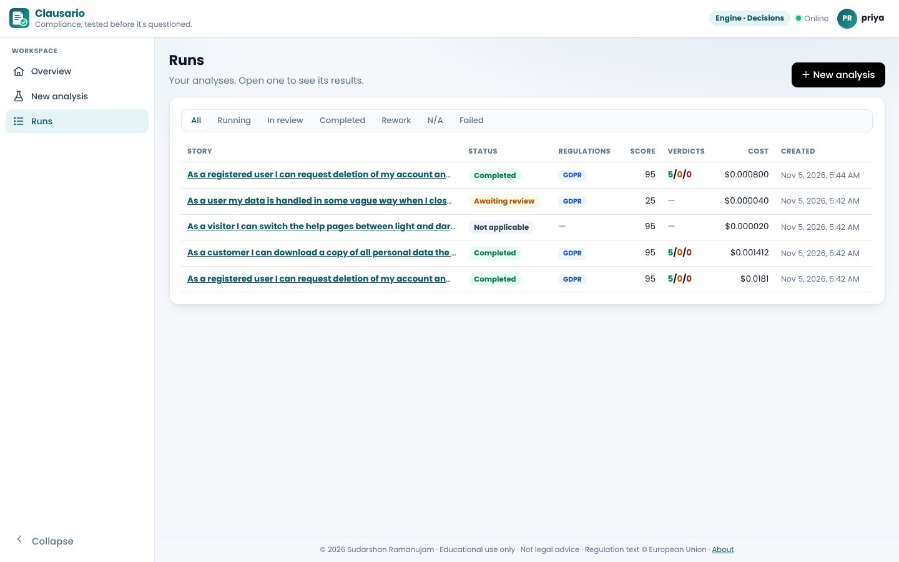

An **Admin** sees every run, with the owner:

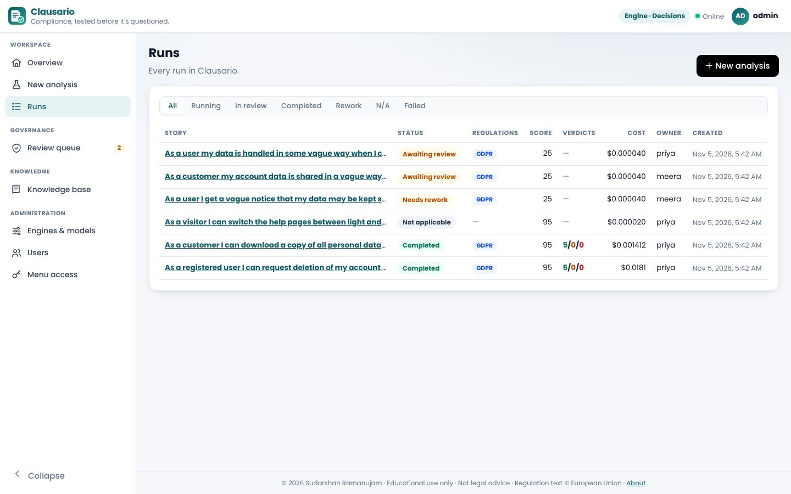

### Run statuses

| Status | Meaning | What to do |
|---|---|---|
| **Running** | The pipeline is working. | Wait; the page refreshes itself. |
| **Awaiting review** | The review score was below the threshold, so the run paused for a person. | A reviewer acts on it from the Review queue. |
| **Completed** | Scenarios generated (and evaluated, if on). | Read the results, export JSON or CSV. |
| **Needs rework** | A reviewer rejected it. | Rewrite the story with more detail and start a new analysis. |
| **Not applicable** | Neither GDPR nor the EU AI Act applies. No scenarios are generated. | Nothing, unless you think the story was misread. |
| **Failed** | An error stopped the run (for example a provider outage after all retries and fallbacks). | Open it and click **↻ Retry**. It continues from the last finished step. |

---

## 7. Run detail

Click any story to open its run.

The header shows the status, regulations, owner and time, the story, a **step tracker** (Classify → Articles → Review → Generate → Evaluate), the **review score** against the threshold, and **↓ JSON** / **↓ CSV** export buttons. Results are in tabs. A tab is greyed out until its step has run.

### Summary

The story, which engine ran each step, the generation provider and model that actually answered (a fallback model shows here if the first one failed), the outcome and the total cost.

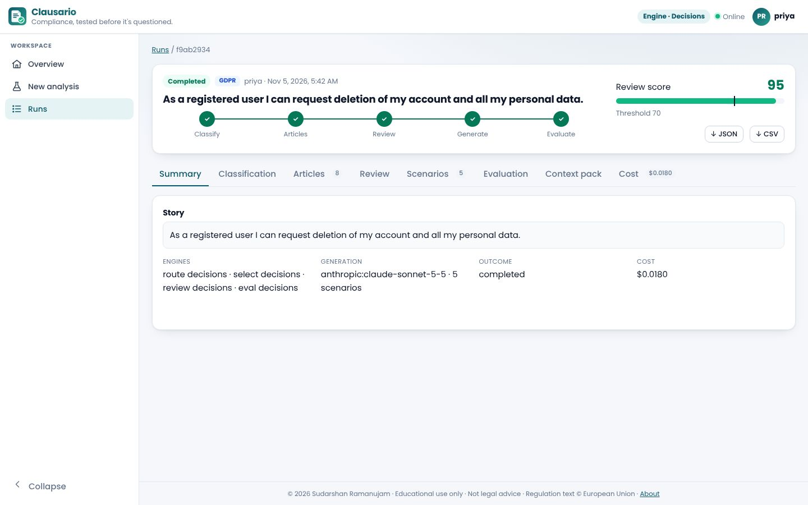

### Classification

How sure the decision engine is that the story involves **personal data** (GDPR) and an **AI system** (EU AI Act), and its overall choice: GDPR, EU AI Act, both or none. The engine and model used are shown underneath.

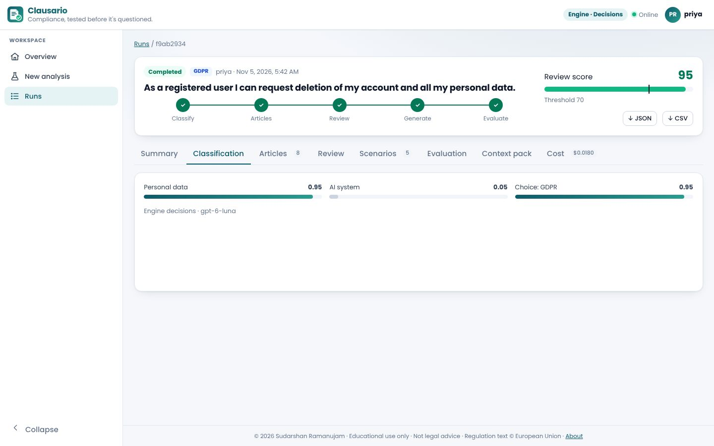

### Articles

The selected articles with their relevance, each linked to its regulation. **Chapter relevance** and **Linked context** (recitals, annexes and cross-references) are collapsed; click to expand.

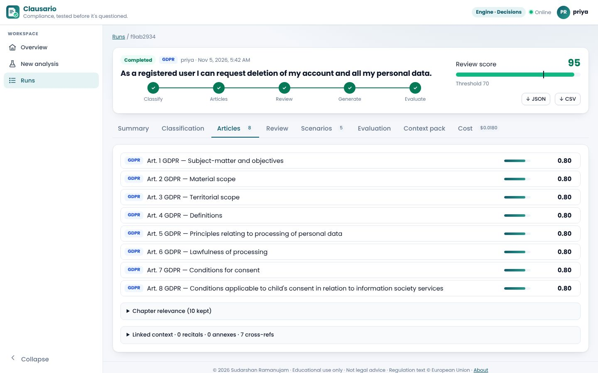

### Review

The Review agent's score breakdown. A decision engine rates four things, and the code turns them into a 0–100 score:

| Part | Weight | Question |
|---|---|---|
| Agreement | 35 | Does a second check agree with the routed regulation? |
| Specificity | 15 | Is the story specific enough to test? |
| Relevance | 30 | Are the selected articles relevant? |
| Completeness | 20 | Is any important article missing? |

At or above the threshold (`REVIEW_THRESHOLD`, 70 by default), the run continues by itself. Below it, the run waits for a person. Any review decisions are logged here.

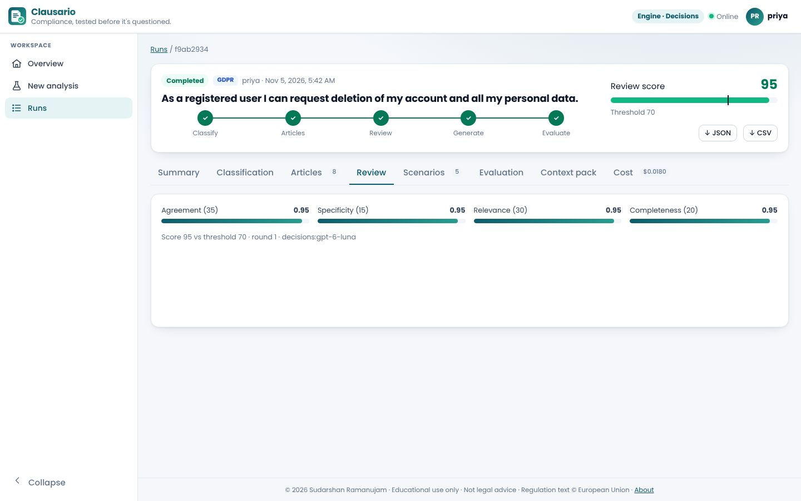

### Scenarios

The generated test scenarios. Filter by verdict (pass / warn / fail) or priority (High / Medium / Low). Each card shows the title, priority, verdict and cited clauses; click it to expand the prerequisites, steps and expected result, or use **Expand all**. Clauses that are not in the context pack are marked ⚠.

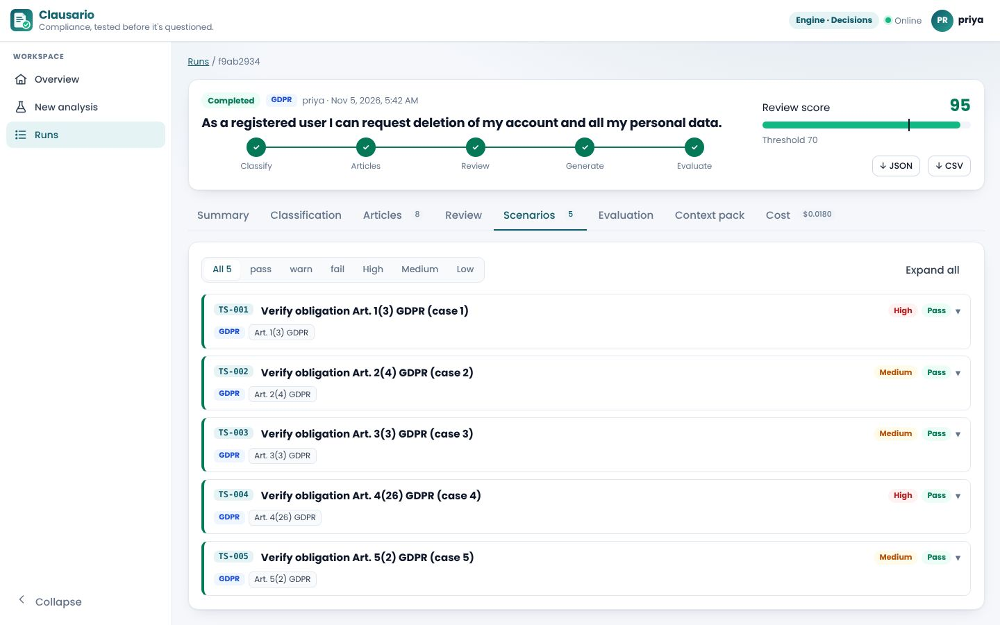

### Evaluation

Counts of **pass**, **warn** and **fail** scenarios, and **coverage**: how many of the selected articles at least one scenario tests. Only shown when evaluation ran.

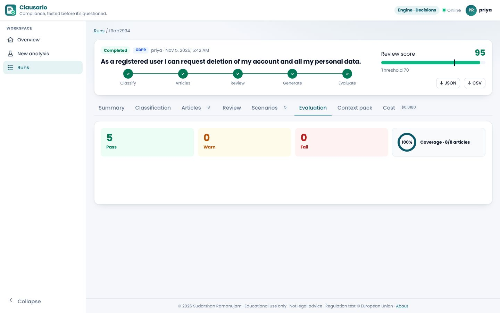

### Context pack

The regulation text sent to the model, within the token budget (`PACK_TOKEN_BUDGET`). Collapsed by default; expand to see what was included and what was dropped.

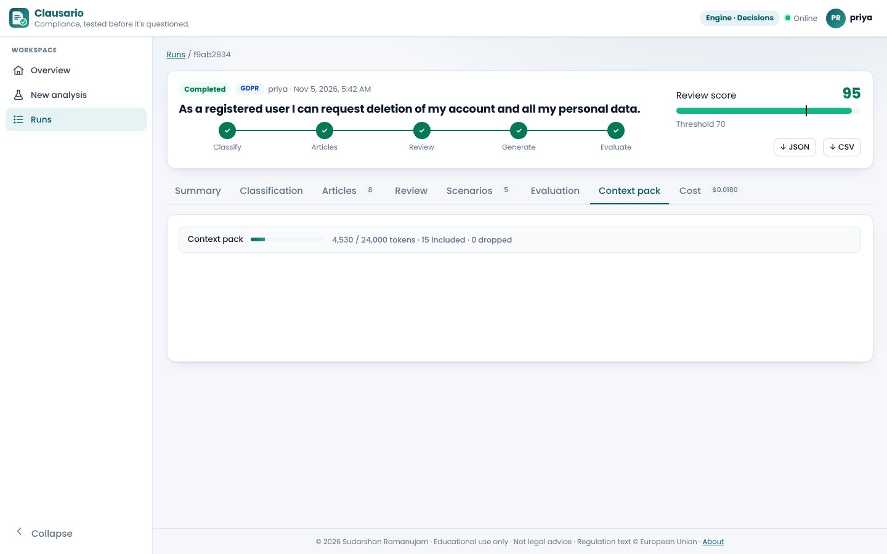

### Cost

Tokens and cost per step (route, select, review, generate, evaluate) with the model that served each one, and the total. Prices come from `MODEL_PRICING` in `.env`.

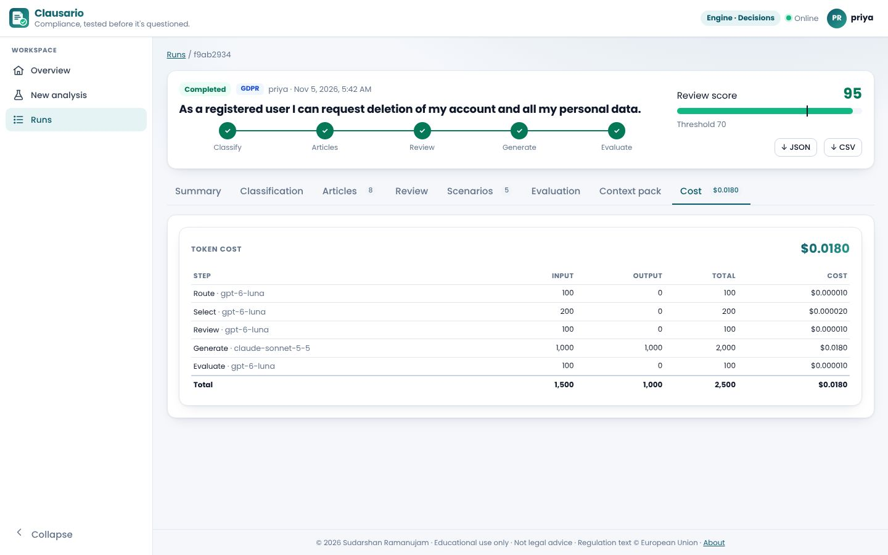

### Other states

**Awaiting review (owner's view).** The owner sees a yellow banner and the score breakdown, but not the review controls (unless they also have the Review queue menu).

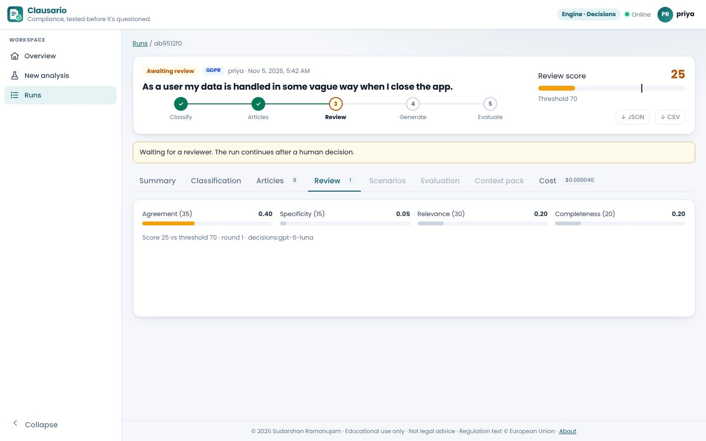

**Not applicable.** The tracker stops after Classify and explains why no scenarios were generated.

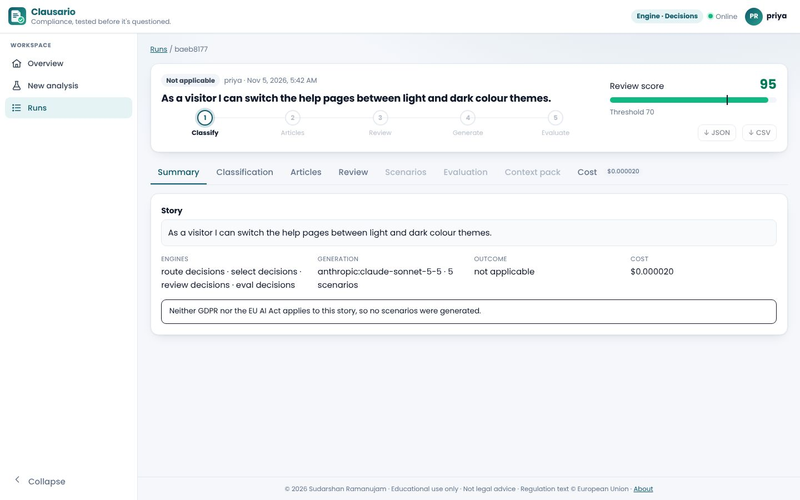

**Needs rework.** A reviewer rejected the run; the Review tab shows who, when and why.

| Summary | Review history |
|---|---|
| 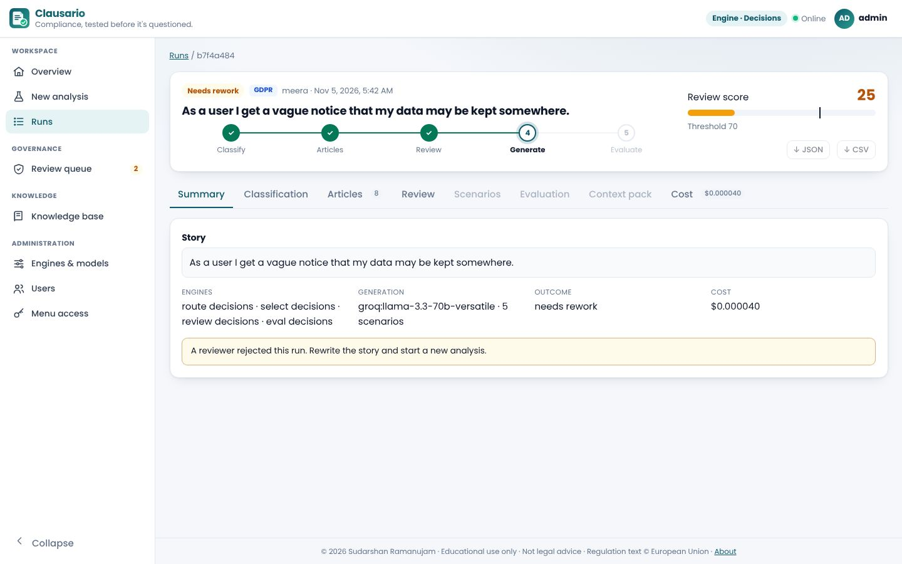 | 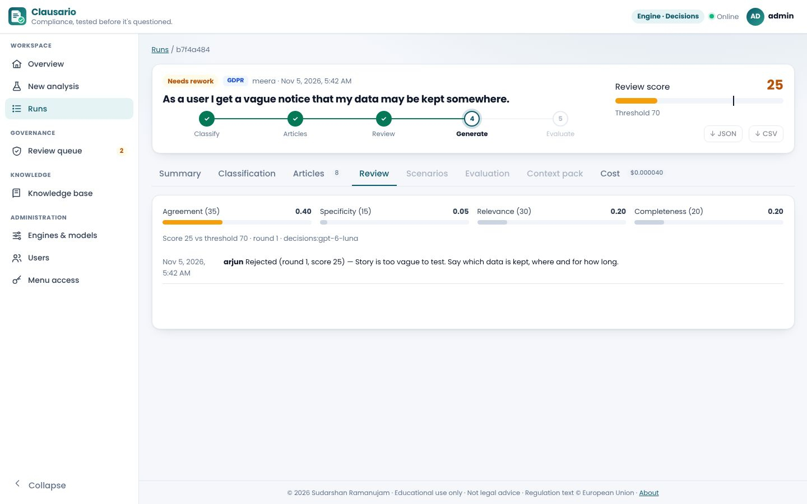 |

### Export

- **↓ JSON:** a `notice` line (educational use only, not legal advice), then story, article IDs, scenarios, evaluation and usage.
- **↓ CSV:** one row per scenario, ready for Excel, with evaluation columns when evaluated.

---

## 8. Review queue (human review)

*Menu: Review queue.* For reviewers and Admins.

Runs that scored below the threshold wait here, oldest first, with their score, regulations, review round, owner and waiting time. Click **Review**.

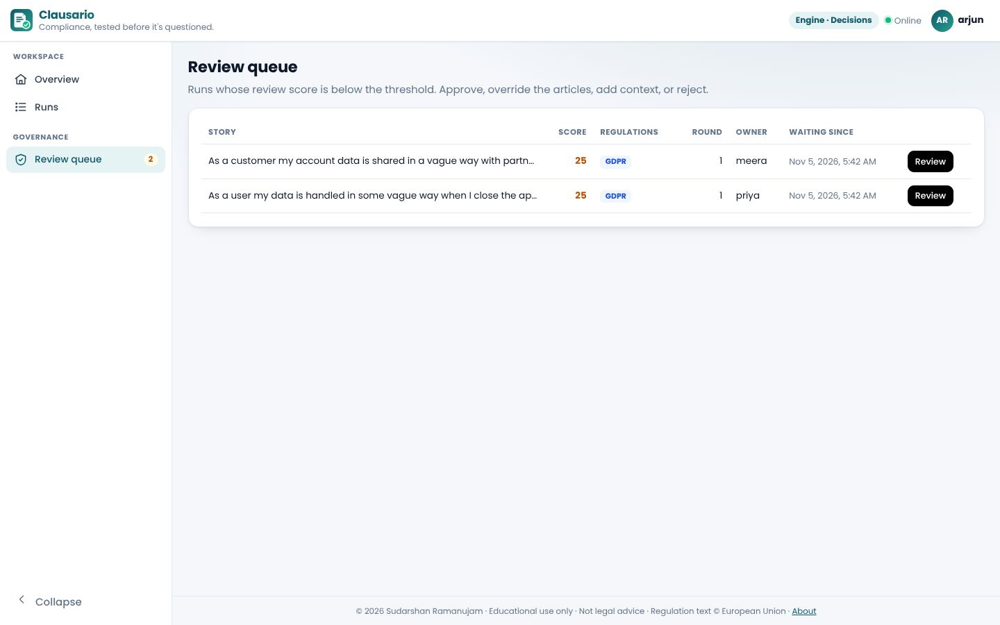

The run opens on the **Review** tab with the review panel:

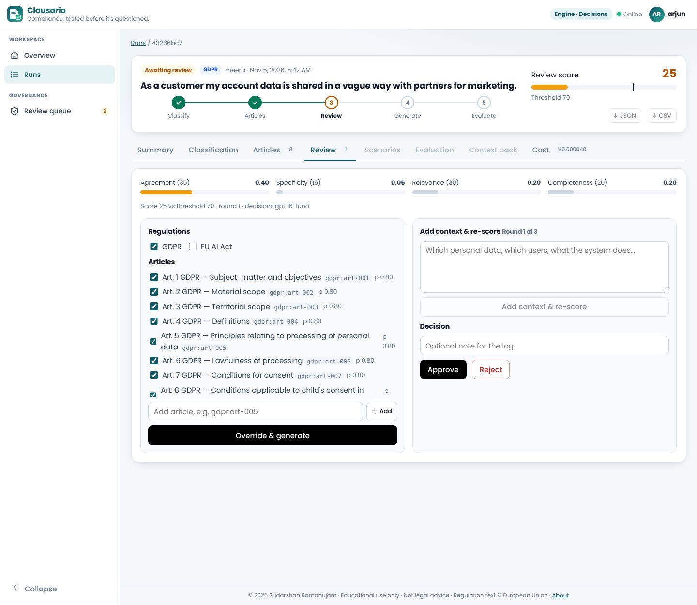

Choose one action:

| Action | Where | What happens |
|---|---|---|
| **Approve** | Decision | Accept the classification and articles as they are. The run generates scenarios and completes. |
| **Override & generate** | Left card | Tick or untick regulations and articles, or add one by ID (for example `gdpr:art-005`) with **+ Add**. The run generates scenarios on your selection. |
| **Add context & re-score** | Right card | Write what the story left out (which data, which users, what the system does). The Review agent scores again: at or above the threshold the run continues; below it, the run comes back to the queue. Limited to `HITL_MAX_ROUNDS` rounds (3 by default; the card shows "Round x of N"). After the last round, approve, override or reject. |
| **Reject** | Decision | End the run as **Needs rework**. The owner rewrites the story and starts again. |

Add an optional **note** for the log with Approve or Reject. If two reviewers act on the same run, the second one gets a message that the run is no longer awaiting review.

---

## 9. Knowledge base

*Menu: Knowledge base.* The regulation text behind every run. Clausario reads it from local files; no search engine or vector database is involved.

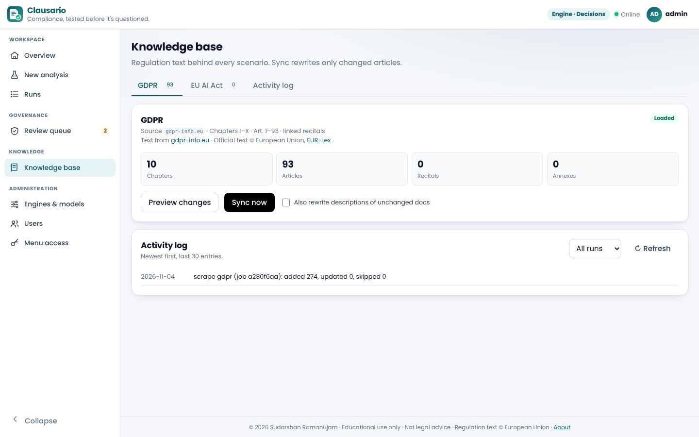

Each regulation has a tab showing its source, a credit line linking to the source site and the official EUR-Lex text, the number of chapters, articles, recitals and annexes, and whether it is loaded.

**First run: load GDPR and the EU AI Act.** A fresh installation has no regulation text, so both tabs show *Empty*. Sign in as Admin (or a user with this menu) and:

1. Open the **GDPR** tab and click **Sync now**. Wait for the job to finish (5–7 minutes).
2. Open the **EU AI Act** tab and click **Sync now** (5–7 minutes).
3. Check that both tabs show article counts. New analyses can now find articles; before this, they end as *Not applicable*.

- **Preview changes** fetches the official text and shows what would change, without writing anything.
- **Sync now** fetches and rewrites only articles that changed. Progress and results appear in the tab, with the token cost if descriptions are written by a model.
- **Also rewrite descriptions of unchanged docs** regenerates the short article descriptions too (uses `DESCRIPTION_MODEL`).

Runs started after a sync use the new text. The **Activity log** tab lists past syncs, newest first; filter by regulation.

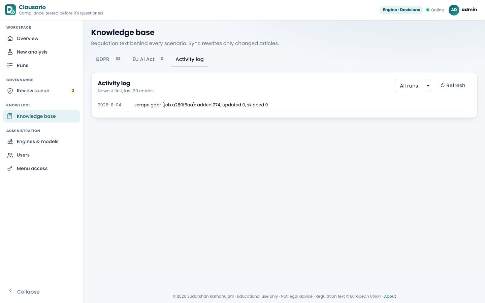

---

## 10. Engines & models

*Menu: Engines & models.* A read-only summary of what `backend/.env` configures. To change anything, edit `.env` and restart the backend.

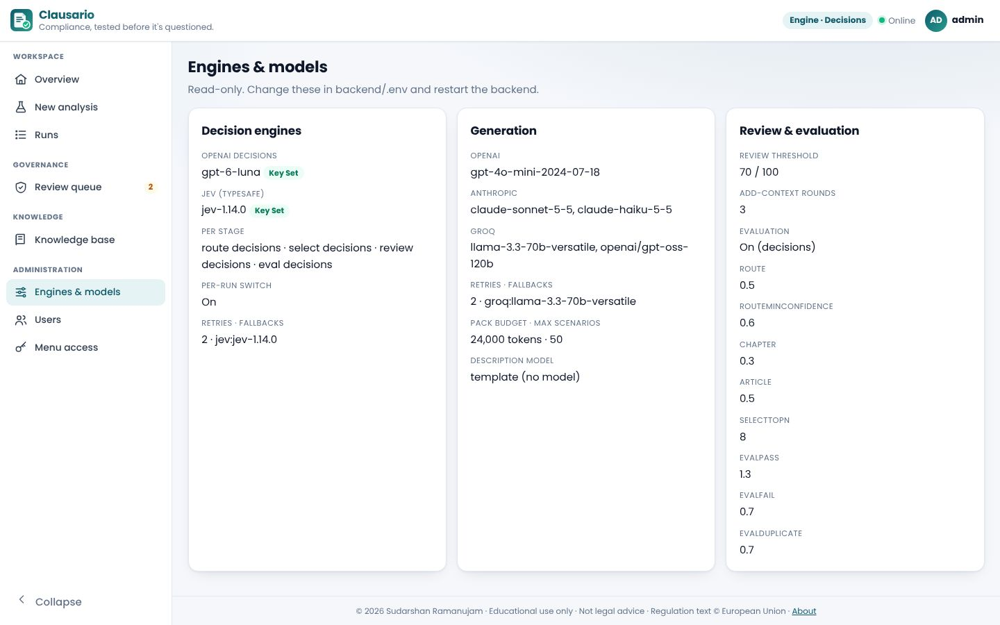

- **Decision engines:** the OpenAI Decisions model and the Jev model (with *Key set* when configured), which engine each step uses, whether the per-run switch is on, and retries and fallbacks.
- **Generation:** the models per provider, retries and fallback models, the context pack budget, the maximum scenario count and the description model.
- **Review & evaluation:** the review threshold, add-context rounds, whether evaluation is on, and the classification, selection and evaluation thresholds.

API keys are never shown.

---

## 11. Users (Admin)

*Menu: Users. Admins only.*

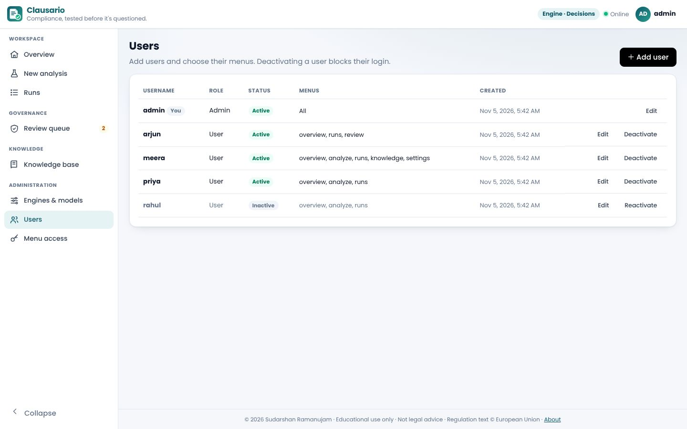

The table shows each account's role, status (Active / Inactive), menus and created date. Your own row is marked **You**.

**Add a user**

1. Click **+ Add user**.
2. Enter a username (3–50 letters, digits, `.`, `_` or `-`) and a password.
3. Choose the role: **User** or **Admin**.
4. Tick the menus. Admins get every menu automatically.
5. Click **Save**. The user can sign in right away.

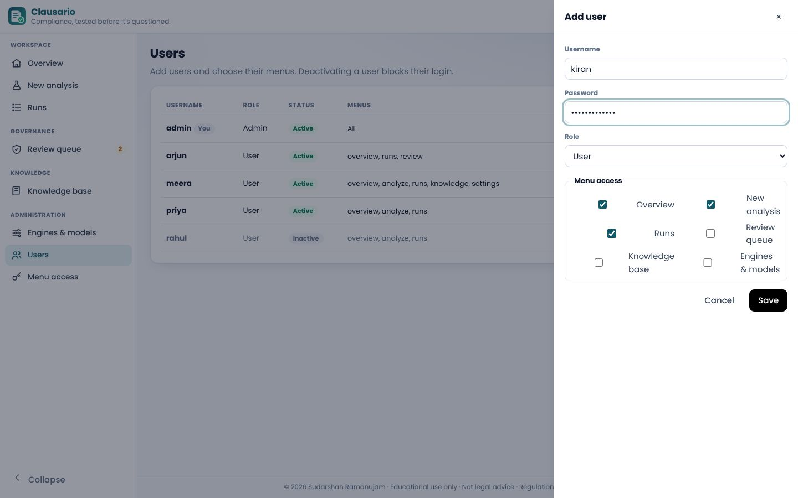

**Edit a user:** click **Edit**. You can set a new password (leave it empty to keep the current one), change the role, turn **Active** off or on, and change menus. The username can't be changed.

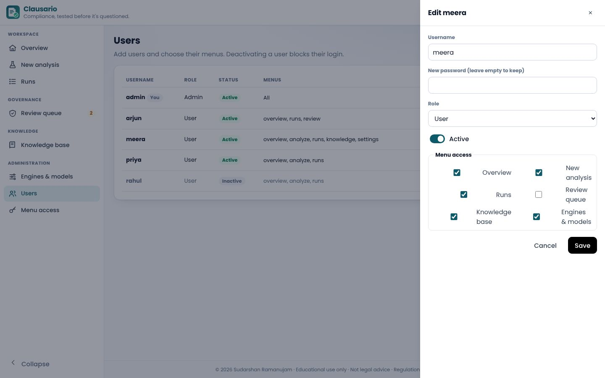

**Deactivate / Reactivate:** blocks or restores the user's login without deleting anything. Their runs stay. Users are never deleted.

**Safety rules:** you can't deactivate or demote yourself, and Clausario always keeps at least one active Admin.

---

## 12. Menu access (Admin)

*Menu: Menu access. Admins only.* A grid of users and menus for changing access quickly.

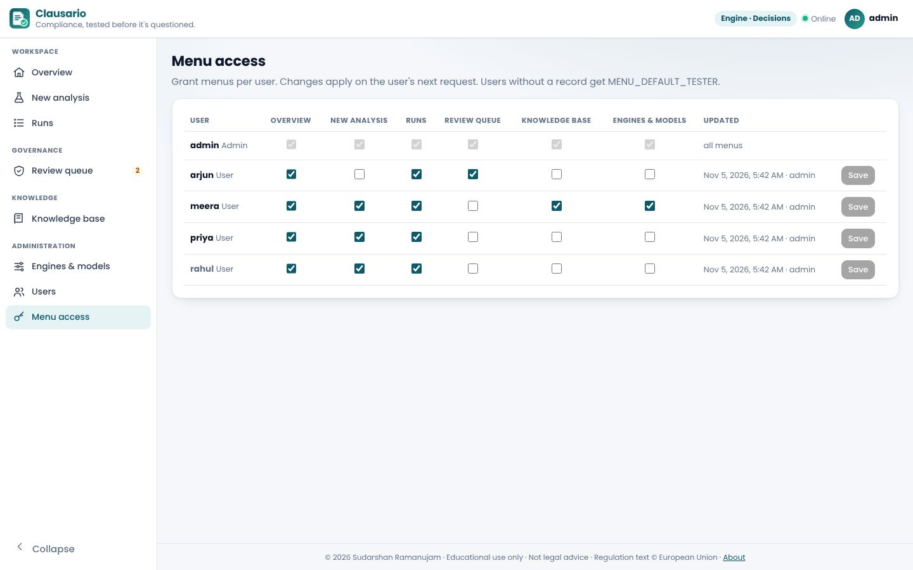

1. Tick or untick menus in a user's row.
2. Click **Save** on that row. The Updated column shows when and by whom.

Admin rows are locked: Admins always have every menu. Users without a saved record get `MENU_DEFAULT_TESTER`. Users and Menu access can't be granted to a User; they are Admin-only.

---

## 13. No access page

Opening a page you don't have, for example from a bookmark or a shared link, shows **No access** instead of the page. Ask an Admin to grant the menu in Menu access.

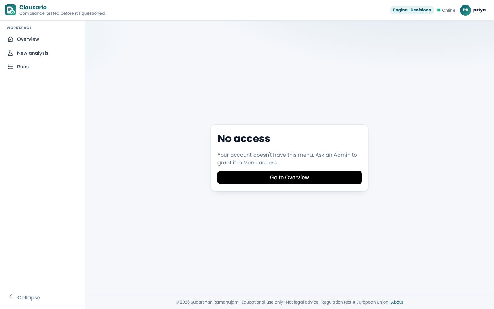

---

## 14. Common tasks

**Analyst: test a new story**

1. New analysis → write the story → **Analyse story →**.
2. Completed: read **Scenarios** and **Evaluation**, then **↓ CSV** for your test tool.
3. Awaiting review: wait for a reviewer. Needs rework: add detail and run again.

**Reviewer: clear the queue**

1. Review queue → **Review** on the oldest run.
2. Check the Classification and Articles tabs.
3. Correct and complete → **Approve**. Wrong articles → **Override & generate**. Story missing facts → **Add context & re-score**. Not testable → **Reject** with a note.

**Admin: onboard a reviewer**

1. Users → **+ Add user**, role **User**, tick Overview, Runs and Review queue → **Save**.
2. Share the username and password through a safe channel and ask them to sign in.

**Admin: remove someone's access**

- One menu: Menu access → untick → **Save**.
- All access: Users → **Deactivate**.

---

## 15. Troubleshooting

| Problem | Likely cause | Fix |
|---|---|---|
| "Invalid username or password" | Wrong details, or the account is deactivated | Check with an Admin. |
| "Too many failed login attempts" | Rate limit after repeated failures | Wait a few minutes. |
| A menu is missing | Not granted, or the group is hidden because it is empty | Ask an Admin to grant it. |
| No access page | You opened a page you don't have | Use the sidebar, or ask for the menu. |
| "Run not found" | The run belongs to someone else, or doesn't exist | Only the owner, Admins and reviewers (for reviewed runs) can open it. |
| Status dot not *Online* | The backend is down or unreachable | Start the backend (`npm run dev` in `backend/`). |
| Run **Failed** | A provider was down after all retries and fallbacks | Open the run and click **↻ Retry**. |
| "No provider configured" in New analysis | No generation API key in `.env` | Add a key and restart the backend. |
| Engine selector missing | `ENGINE_UI_SWITCH=false` | Runs use the default engine. |
| Evaluation toggle missing | `EVAL_ENABLED=false` | Turn it on in `.env` if you need evaluation. |
| Add context is greyed out | `HITL_MAX_ROUNDS` reached | Approve, override or reject. |

For installation and configuration, see [Installation.md](../Installation.md).
